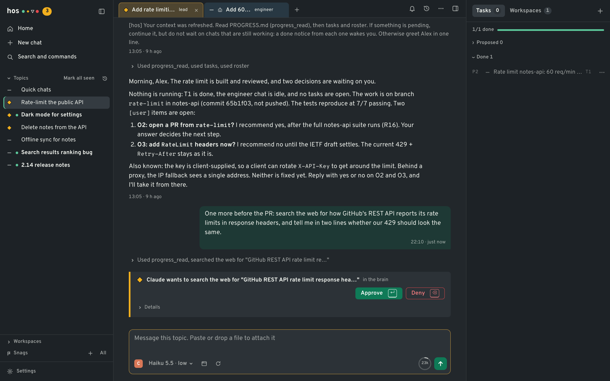

# hos

**Run your coding agents like a team that remembers.**

[Product page](https://gethos.vercel.app) · [Install](https://gethos.vercel.app/docs/install/) · [Docs](https://gethos.vercel.app/docs/what-hos-is/) · [Latest release](https://github.com/Harinder441/hos/releases/latest)

<!-- V2 video: replace this image with a thumbnail that links to the video -->


hos is a small server on your own computer. It runs Claude Code, or any agent that speaks ACP, as chats
inside topics. A lead chat splits the work into tasks; helper chats claim them, lock the files they edit and
message each other. What they learn lands in your **brain**, a private git repo you own. One web app, on your
computer or your phone.

## Start in one prompt

Copy the prompt from the [Install page](https://gethos.vercel.app/docs/install/) into the coding agent you
already use. It checks the install file's hash, tells you what it will change, and stops for the steps only
you can do (sign-ins, your passkey).

macOS, Linux or WSL2 · Node 22, git, a C/C++ toolchain · no API key: Claude runs under your own login.

## What you get

- **Team.** Topics, a lead and helper chats with roles, a task list, file locks, chat-to-chat messages.
- **Memory.** A work folder with a `PROGRESS.md` per job, handoffs to a fresh chat when you ask, a daily history.
- **Brain.** Your agents' setup is a git repo you own. hos commits what chats write there.
- **Code.** Workspaces and worktrees per job, stable ports, dev servers, terminals, a diff view whose line comments
  go to the chat, and Code view (hos-code) for whole repos and pull requests.
- **Control.** Every tool call gets an action class you set to auto, ask or deny; a governor keeps chats inside your
  plan's limits; one switch stops every agent.
- **Anywhere.** Install the web app on your phone, get push, approve from there. hos listens on localhost only; reach
  it through your own Tailscale tailnet or Cloudflare Tunnel, signed in with a passkey.
- **Agents.** Claude Code runs under your own Claude login. Any agent that speaks the Agent Client Protocol plugs in
  through the generic ACP harness.

## Docs

The docs are in [`docs/site/`](docs/site/), one Markdown file per page:

1. [What hos is](docs/site/src/content/docs/docs/what-hos-is.md)
2. [Install](docs/site/src/content/docs/docs/install.md)
3. [First hour](docs/site/src/content/docs/docs/first-hour.md)
4. [Features](docs/site/src/content/docs/docs/features.md)
5. [Your brain](docs/site/src/content/docs/docs/your-brain.md)
6. [Make it yours](docs/site/src/content/docs/docs/make-it-yours.md)
7. [Extend hos](docs/site/src/content/docs/docs/extend-hos.md)
8. [Add a harness](docs/site/src/content/docs/docs/add-a-harness.md)
9. [Security and sign-in](docs/site/src/content/docs/docs/security.md)
10. [What we learned](docs/site/src/content/docs/docs/what-we-learned.md)
11. [Updating and uninstalling](docs/site/src/content/docs/docs/updating.md)
12. [Troubleshooting](docs/site/src/content/docs/docs/troubleshooting.md)
13. [FAQ and contributing](docs/site/src/content/docs/docs/faq.md)

Pages 6 and 7 are built from the recipes of the `hos` skill in [`skills/hos/recipes/`](skills/hos/recipes/), the same
files your agent follows when you ask it to change hos.

## Develop

```sh
npm ci
npm start                 # builds the web app and the server, then serves both on 127.0.0.1:4517
npm run check -- <areas>  # type check plus the unit tests for the areas you touched (--list shows them)
npm run check:e2e -- <areas>   # Playwright, when you changed web/ or an HTTP route
npm run test:full         # everything, once, before a pull request
```

Tests drive hos only through its client API, with fakes for the agent, the network and the clock, temp git repos and
a separate tmux socket. They never touch your real repos, logins or subscriptions.

- `src/`: the server (Node 22, TypeScript, SQLite); `src/main.ts` is the `hos` command.
- `web/`: the web app (React, Vite).
- `skills/`: the skills hos ships into your brain, including `hos` and its recipes.
- `schemas/`: the JSON schemas `hos validate` checks a brain against.
- `docs/site/`: the docs site and product page (Astro Starlight, its own npm package).

To change hos with an agent, ask it to use the `hos` skill's `change-hos` recipe.

## Licence

Apache-2.0. hos-brain is MIT; hos-code is MIT and keeps its original author's notice.

Not affiliated with Anthropic. Claude is a trademark of Anthropic.
