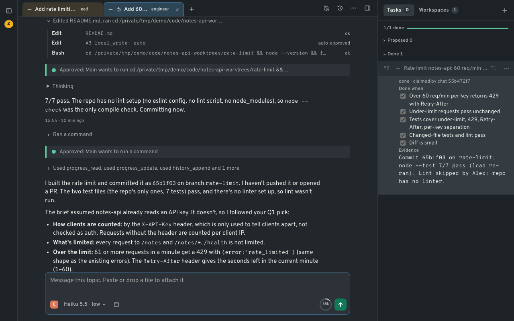
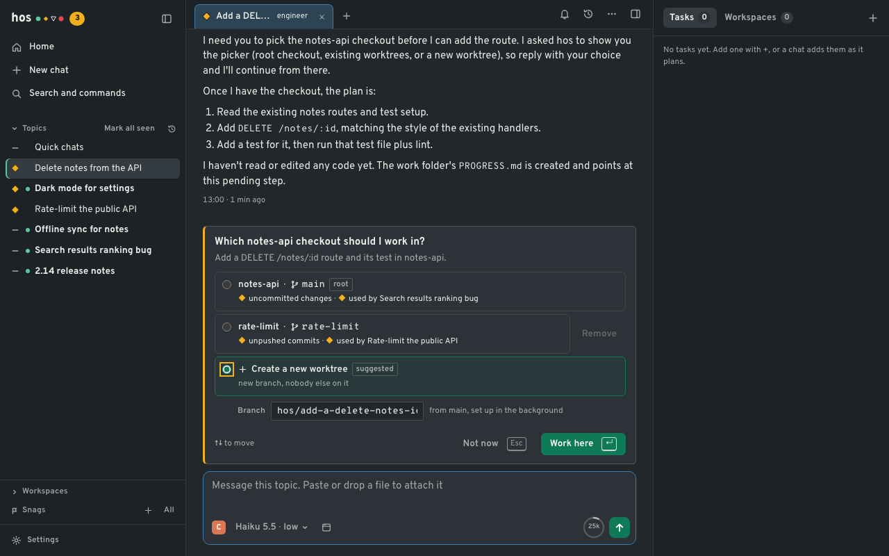
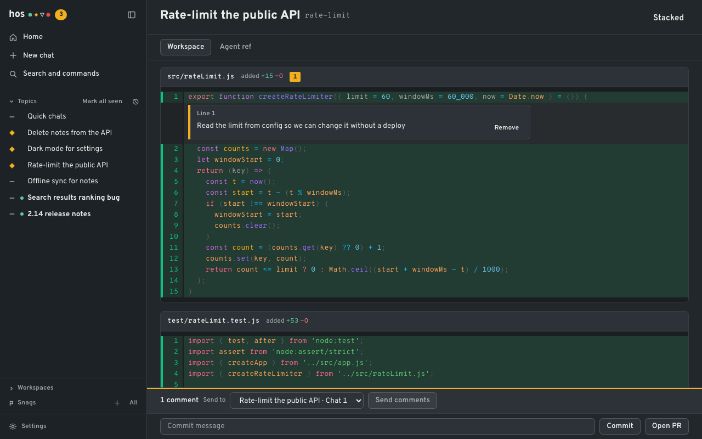
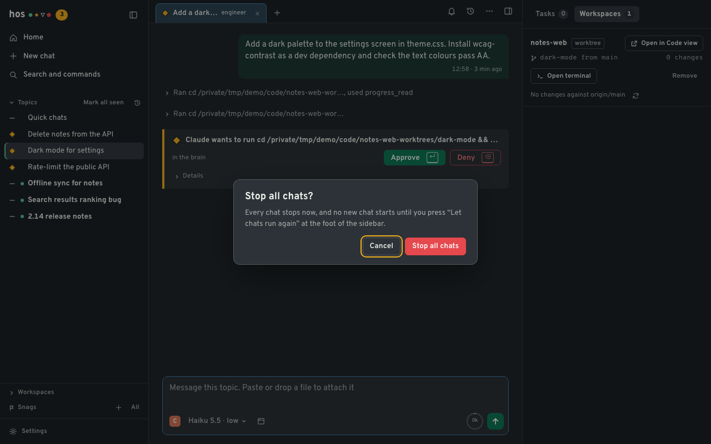
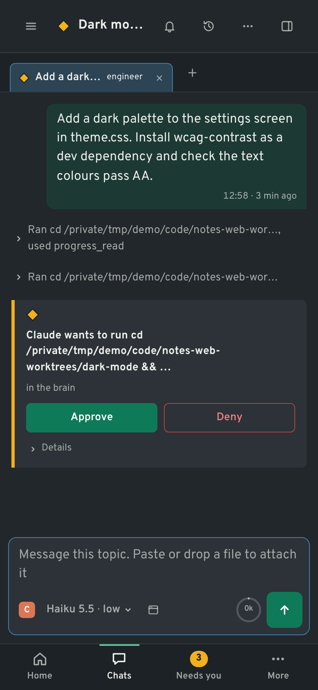

Here is everything hos does, one line each. For how any of it works, ask your agent: "how does hos do X?" It can
read the source.

## Chats and topics

- **Topics.** A piece of work gets one topic. All its chats, files and progress live together.
- **Many chats at once.** Run several agent chats at once (6 Claude chats by default; you set the slots). hos queues the rest.
- **Helpers.** A chat can start helper chats (worker, reviewer, scout). Each one shows as its own tab.
- **Chat-to-chat messages.** Chats in a topic can message each other. Messages from chats are labelled, so they never pass for you.
- **Profiles.** Pick how a chat behaves: generic (everything), lead, engineer, product, ritual (for schedules), or one you write.
- **Plans.** A chat can ask for sign-off on a plan before it starts. You approve on the plan card or reply in the chat.
- **Handoffs.** When a chat gets long, it writes a handoff file and a fresh chat carries on from it: when you ask, or at a line a profile sets.
- **Quick chats.** Turn on **Quick** in New chat for a one-off question that doesn't need its own topic. It goes to the standing Quick chats topic.

## Your brain

- **One brain.** Every chat gets your brain, a git repo of your rules, profiles, skills and notes, whatever repo it works in.
- **Auto-commit.** hos commits what each chat wrote, one commit per chat per turn. When the brain has an `origin` and is on `main`, hos merges `origin/main` and pushes on its own, never forcing; a merge conflict pauses pushing.
- **Progress doc.** Each topic has one `PROGRESS.md`. Chats update it; it is what a new chat reads first.
- **History.** Every deliverable adds an entry to the day's history file: asked, did, wrote, open.
- **Skills.** Skills in your brain load in the chats whose profile allows them (generic gets all). hos ships its own; `hos skills sync` refreshes them and keeps the ones you edited.

## Code

- **Workspaces.** Attach a repo or a worktree to a topic. Chats work there; hos asks you which checkout to use.
- **Worktrees.** hos can cut a worktree per branch, with its own stable port.
- **Dev servers.** Start and stop dev servers per worktree, with a preview link.
- **Terminals.** Real terminals in the browser. Take over a chat's session when you want to type yourself.
- **Code view.** Browse any repo, read diffs, review pull requests, commit and push, through hos-code.
- **Diff comments.** Comment on a line of a diff; the comment goes to the chat.
- **Locks and tasks.** Chats claim tasks and lock folders, so two chats don't edit the same files.

## Control

- **Approvals.** Every tool call falls into an action class, from reads to brain config. Each class is auto, ask, ask every time or deny. You approve from a card.
- **Governor.** hos watches your plan's 5-hour and weekly windows. As a window fills it starts new helpers on smaller models, then runs only the most important work, then pauses batch work until the window resets.
- **Idle suspend.** A quiet chat's process stops after 30 minutes. Your next message resumes the same session.
- **Actions.** Name a command once; run it from the UI.
- **Schedules.** Run a chat on a schedule, unattended, with the rights you give it.
- **Snags.** Capture a bug or idea in one line. A chat can pick it up later.

## Home

- **Needs you.** Open plans, questions and approvals from every topic, in one list.
- **Tasks, capture, calendar.** Home has sections for your tasks, a capture box and today's calendar. Each one reads from a **data source**.
- **Data sources.** hos ships a local one for tasks, capture and snags. The calendar stays hidden until you connect a source. To show your own task app or calendar, ask your agent to build a source with the hos skill's "add a data source" recipe. hos ships no code for any particular app.

## Make it yours

- **The hos skill.** One skill hos copies into your brain, with 15 recipes: create a profile, add a skill, a schedule, an action, change approvals, add a harness, add a data source and more. Ask your agent to use it. [Make it yours](../make-it-yours/) and [Extend hos](../extend-hos/) are built from the same recipe files.
- **The generic profile.** Can use every feature and tool, so you can try everything before you make narrower profiles.
- **Canvases and diagrams.** Chats can draw on a shared board and open canvases you can see live.

## Anywhere

- **Phone.** Install the web app on your phone. Get push notifications. Approve from there.
- **Passkey.** One passkey signs you in. No passwords.
- **Remote access.** Reach hos over Tailscale or a Cloudflare tunnel. hos itself only listens on localhost.
- **Computers.** Pair a second machine you own and run chats on it from the same app.

## Agents

- **Claude.** Runs the real Claude Code under your own Claude login. hos never sees your credentials.
- **Any ACP agent.** Agents that speak the Agent Client Protocol plug in through the generic ACP harness.
- **Add your own.** An ACP agent is one entry in your policy's `harnesses:` list; any other agent is one plug-in file in your brain. See [Add a harness](../add-a-harness/).

## What it looks like

