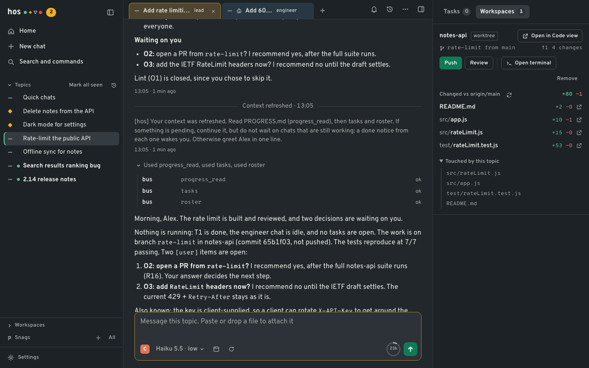
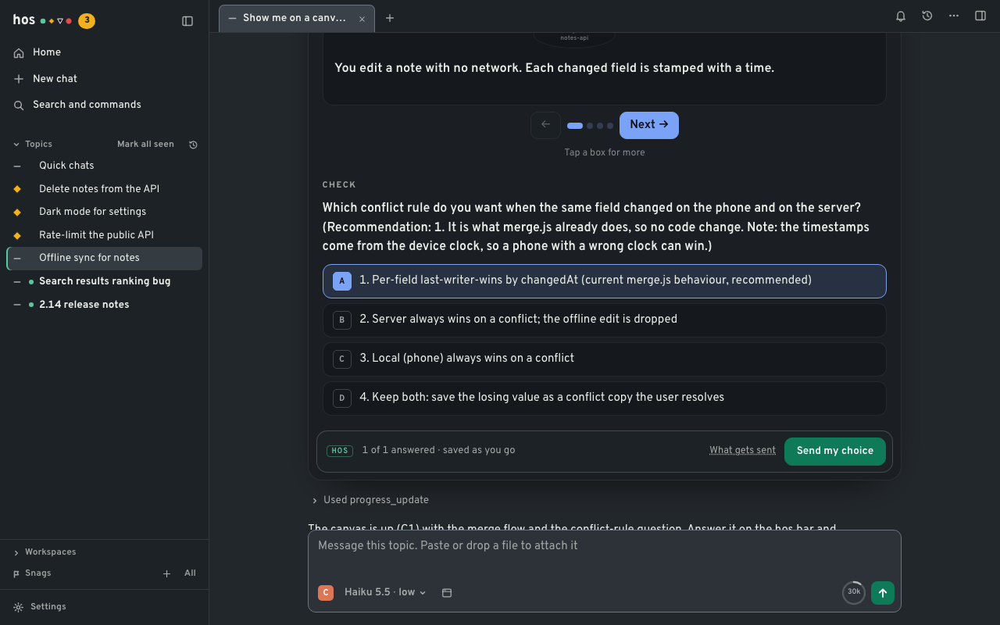

Start a new chat. The profile is **generic**, which can use every hos feature and tool. Try these in order.

## 1. Make a topic

A topic is one piece of work. Its chats, files and progress live together. Click **New chat** (⌘N), describe a real
task ("Fix the flaky login test") and send it. hos starts a topic and names it from your message.

The chat gets a work folder in your brain with a `PROGRESS.md`. Open it after a few turns: the chat keeps it true,
and it is what the next chat reads first.

## 2. Start a helper

Ask: "Start a helper to read the test logs and tell you what fails." A helper chat opens as its own tab, does its
part and reports back. Chats in a topic can message each other. Their messages are labelled, so they never pass for
yours.

## 3. Ask for a plan

Ask for something bigger: "Plan how you would split this into tasks, then wait." The chat writes a plan and asks
for sign-off on a plan card. Answer its questions in the chat. Answering a question is not a go; press **Approve
plan** or say "go ahead" when you want it to start.

## 4. Open a canvas

Ask: "Explain how this part of the code works on a canvas." The chat draws a flow, a diagram or a set of choices you
can see live and click through. When you pick an option, it goes back to the chat as your message.

## 5. File a snag

See something odd? Type it in one line in the Snags box. A chat can pick it up later, or you can ask one to sweep
them.

## Then

- Attach a repo to the topic. hos asks which checkout to use: the main one, an existing worktree, or a new one.
- Install the web app on your phone. See [Security and sign-in](../security/) for remote access.
- When you notice you keep typing the same instructions, ask: "Use the hos skill to create a profile." See
  [Make it yours](../make-it-yours/).
