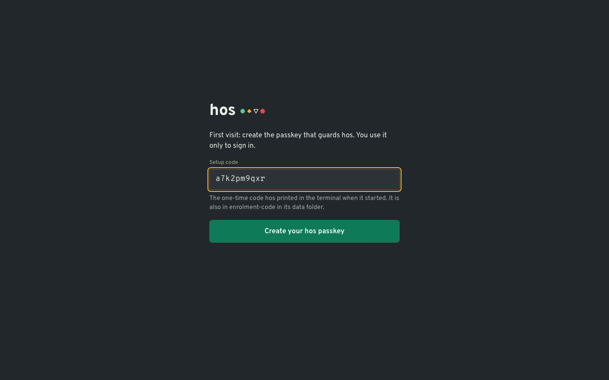

You install hos by asking your own coding agent to do it. Claude Code works, and so does any agent that can run
shell commands. You see and approve every command it runs.

## The prompt

Paste this into your agent, in any folder:

<!-- TODO-T19: the release job writes the tag and the SHA-256 into this block. -->

```text wrap
Install hos on this computer. Download https://raw.githubusercontent.com/Harinder441/hos/v0.1.0/install/INSTALL.md with curl, check that its SHA-256 is <hash>, and stop if it is not. Tell me in five lines what it will change, then follow it exactly.
```

The URL points at one release tag, and the hash proves your agent got the same bytes we published. Open the URL in
a browser first if you want to read every step. The file is written for an agent to follow and for a person to
read.

## What it changes

| What | Where (default) | How |
|---|---|---|
| **hos**, the app | `~/code/hos` | git clone (or your fork), `npm ci`, build |
| **hos-code**, the code viewer | `~/.local/bin/hos-code` | release binary, checked against its checksum (optional) |
| **Your brain** | `~/hos-brain` | a copy of `hos-brain`, pushed to a new **private** repo you own |
| hos's data | `~/.hos/` | created on first start |
| Start at login | a macOS LaunchAgent or a systemd user unit | only if you say yes |

Nothing else on your machine changes. hos and the install never run `sudo`. If a prerequisite is missing, the agent
shows you your package manager's command and you run it yourself; on Linux there is also an optional hint to keep
hos running while you are logged out (`sudo loginctl enable-linger`). There is no `curl | sh`, and no hos
package from the npm registry: dependencies come from the pinned lockfile in the release.

## Before you start

- macOS or Linux.
- Node 22 or newer, git, and a C/C++ toolchain (Xcode command line tools, or `build-essential`).
- A Claude account. hos brings the Claude Code binary it runs; you sign it in with your own account.
- `gh` signed in, if you want the agent to create your private brain repo for you.
- Optional: tmux (terminals, dev servers), Tailscale or Cloudflare (phone access).

## The questions it asks

The agent asks these once, all together, with defaults shown:

1. Code folder (`~/code`).
2. hos: clone the public repo, or fork it first if you plan to send changes back.
3. hos-code: release binary, build from source, or skip.
4. Brain folder (`~/hos-brain`).
5. Brain on GitHub: a new private repo now, or local only for now.
6. Your name and timezone (it passes them to `hos init --name … --timezone …`).
7. Start hos at login.
8. Phone access: later, or now through Tailscale.

## Where it stops for you

- **Sign-ins.** `gh auth login` and `claude auth login`, only if you are not signed in. The agent never signs in for
  you.
- **Toolchain.** If it is missing, the agent shows you the command (`xcode-select --install`, or your distro's
  package command) and you run it.
- **Commit address.** Before the first commit in your brain, it shows the email git will use and asks if that is
  right.
- **Passkey.** You open `http://localhost:4517`, paste the one-time enrolment code from `~/.hos/enrolment-code`
  (you open that file yourself), and save a passkey.



## How it ends

The install ends in a chat with the **generic** profile. Ask it "What can you do in this brain?". Generic can use
every hos feature and tool, so you can try everything before you make narrower profiles. Then read
[First hour](../first-hour/).

The agent prints everything it created. To update or remove it later, see
[Updating and uninstalling](../updating/).

## If something fails

The agent stops, shows the output and the step's "if it fails" line, and asks you. It does not invent another
install route, force a push, or delete a folder it did not create. See [Troubleshooting](../troubleshooting/).
