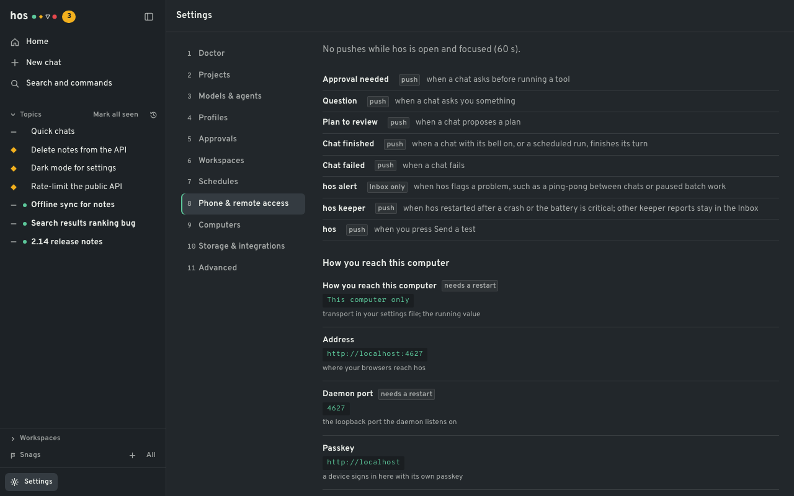

## The short version

- hos listens on `localhost` only. Remote access goes through a transport you choose.
- You sign in with a passkey. There are no passwords.
- Your agents sign in with your own accounts, through their own login. hos never sees those logins. A key you put
  into a harness's environment yourself sits in plain text in your brain's `hos/policy.yaml`, which hos commits and
  pushes to your private repo.
- Every tool call an agent makes goes through your approvals policy.
- A message from a chat never counts as your approval.

## Your Claude login

hos runs the real, unmodified Claude Code under your own Claude account. You sign in with `claude auth login`, in
Claude's own flow. hos opens that login in a terminal when you need it, and runs `claude auth status` to show
whether you are signed in. That is all it does with it.

- hos never reads, copies or stores your Claude credentials.
- hos never asks for an API key, and clears API-key variables from the chats it starts, so usage always comes from
  the account you signed in with.
- Usage counts against your own plan's limits. The governor watches them for you.

## Passkey

The first time you open hos, it asks for a one-time enrolment code from `~/.hos/enrolment-code`, then saves a
passkey for that address. A sign-in lasts 30 days, then you sign in again with the same passkey. A new address (for
example your Tailscale name) needs its own passkey and a fresh code, which hos writes on restart.

## Remote access

hos itself only listens on `localhost`. To use it from your phone, put one of these in front of it:

- **Tailscale.** Publish it inside your own tailnet with `tailscale serve`. Never Funnel.
- **Cloudflare.** Your own Cloudflare Tunnel behind a Cloudflare Access login.

No relay of ours sits in the path. You pick the transport in first run, and later in **Settings → Phone & remote
access**; it is the `transport:` key in your brain's `hos/policy.yaml`. The hos skill's
[Set up phone access](../make-it-yours/#set-up-phone-access) recipe walks your agent through it.

## Approvals

Every tool call falls into an action class, from reading a file to pushing a branch to changing brain config. Your
policy sets each class to **auto**, **ask**, **ask every time** (no "always allow" on the card) or **deny**. When a
call asks, you get an approval card in the chat and on your phone.

- With no policy at all, reads run and everything else asks. Pushes, pull requests and deploys ask every time.
- A tool hos doesn't know asks by default.
- hos's own tools (tasks, locks, messages, progress) run without a card.
- Every decision, automatic or not, is logged with its class, its reason, where it was made and when.
- Chats can message each other, but those messages are labelled. A tool approval only counts when it comes from you,
  through the card. A plan counts as approved when you press Approve plan, or when the chat quotes your own latest
  message saying so; never on another chat's word.
- One switch stops every agent.

## Your brain and plug-ins

- hos commits your brain on every turn. When the brain has an `origin` and is on `main`, hos merges `origin/main`
  and pushes on its own, never forcing; a merge conflict pauses pushing.
- Your brain's `hos/` folder holds your policy and any plug-ins. The server runs plug-in code with its own rights,
  so hos asks you first before an agent changes plug-in code, the plugins list or harnesses when your policy says so
  (`approvals.plugin_edits: ask_every_time`, set in the starter brain).

## Push notifications

Push goes through your browser's push service. The payloads are encrypted for your device.

## Not covered

- hos is built for a computer where yours is the only user account. No token is on a command line: Claude chats get
  theirs through a pipe and the code viewer reads files in `~/.hos`, which only you can read. Another local account
  can still see your command lines (paths, chat ids, and a terminal chat's instructions) and reach hos's local ports,
  where the passkey, the bus token or the viewer login stops it. An agent run through a plug-in harness gets the bus
  token through its input, and hos cannot follow what it does with it; if you use one, keep to one account per computer.
- hos does not sandbox your agents. They run with your user's rights, limited by your approvals policy and the
  agent's own permission settings.
- Pair only computers you own. A paired computer runs chats with that machine's rights.

## Reporting a problem

See `SECURITY.md` in the hos repo for how to report a vulnerability privately.
