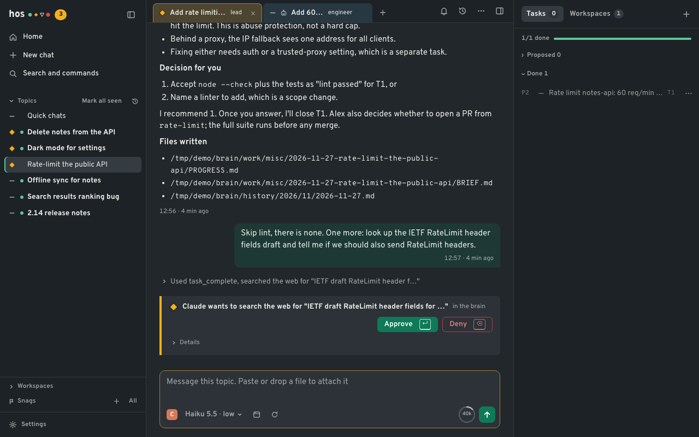

hos is a small server on your own computer. It runs your coding agents as chats, keeps them organised, and serves
one web app you open on the computer or your phone.

One agent is a chat. Five agents are a team, and a team needs things a chat doesn't have: someone who splits the
work, a task board, a way to stop two of them editing the same file, and a memory that outlives the session. hos
gives them that.

- **A lead and helpers.** A lead chat splits the work into tasks and starts helper chats with a role.
- **Tasks and locks.** Chats claim tasks and lock the folders they edit.
- **A brain.** Rules, skills, profiles and progress live in one git repo you own. Every chat gets its rules and
  writes its progress there, whatever repo it works in, so the next chat starts where the last one stopped.
- **You stay in charge.** Every tool call falls into a class you set to auto, ask, ask every time or deny. You
  approve from a card, on the computer or the phone.

## The three repos

| Repo | What it is | Licence |
|---|---|---|
| `hos` | The server and the web app, plus the `hos` skill and its recipes, which it copies into your brain | Apache-2.0 |
| `hos-brain` | The starter brain: five profiles, seven skills, example settings and lessons | MIT |
| `hos-code` | The code viewer behind **Code view**: browse a repo, read diffs, review pull requests | MIT |

Your brain starts as a copy of `hos-brain` and becomes a private repo you own. See [Your brain](../your-brain/).

## What hos is not

- **Not a hosted service.** It runs on your computer. What leaves it is what your agents send, plus what you turn
  on: push notifications, remote access, paired computers and an optional health-check ping.
- **Not a model.** Bring your own agent and your own plan. Claude is built in; any agent that speaks the Agent
  Client Protocol plugs in.
- **Not finished.** It is young software, used every day by its author. Rough edges are filed as snags.

## Where to go next

- [Install](../install/): one prompt into your own agent.
- [First hour](../first-hour/): five things to try.
- [Features](../features/): everything hos does, one line each.
